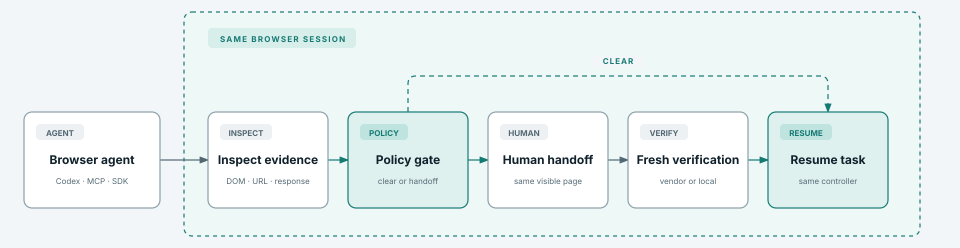

<p align="center">
  <a href="README.md">English</a> · <a href="docs/readme/README_ar.md">العربية</a> ·
  <a href="docs/readme/README_de.md">Deutsch</a> · <a href="docs/readme/README_el.md">Ελληνικά</a> ·
  <a href="docs/readme/README_es.md">Español</a> · <a href="docs/readme/README_fa.md">فارسی</a> ·
  <a href="docs/readme/README_fr.md">Français</a> · <a href="docs/readme/README_id.md">Bahasa Indonesia</a> ·
  <a href="docs/readme/README_it.md">Italiano</a> · <a href="docs/readme/README_ja.md">日本語</a> ·
  <a href="docs/readme/README_ko.md">한국어</a> · <a href="docs/readme/README_pl.md">Polski</a> ·
  <a href="docs/readme/README_pt-BR.md">Português (Brasil)</a> · <a href="docs/readme/README_ru.md">Русский</a> ·
  <a href="docs/readme/README_th.md">ไทย</a> · <a href="docs/readme/README_tr.md">Türkçe</a> ·
  <a href="docs/readme/README_uk.md">Українська</a> · <a href="docs/readme/README_vi.md">Tiếng Việt</a> ·
  <a href="docs/readme/README_zh.md">简体中文</a> · <a href="docs/readme/README_zh-TW.md">繁體中文</a>
</p>

<h1 align="center">rea-captcha</h1>

<p align="center"><strong>Local-first verification challenge intelligence for browser agents.</strong></p>

<p align="center">
  <a href="https://www.npmjs.com/package/rea-captcha"></a>
  <a href="https://github.com/masakaai/rea-captcha/actions/workflows/ci.yml"></a>
  <a href="https://github.com/masakaai/rea-captcha/actions/workflows/web-demo.yml"></a>
  <a href="https://rea-captcha.vercel.app"></a>
  <a href="https://registry.modelcontextprotocol.io/v0.1/servers?search=io.github.masakaai%2Frea-captcha"></a>
  <a href="docs/mcp-tools.md"></a>
  <a href="https://skills.sh/masakaai/rea-captcha/rea-captcha"></a>
  <a href="https://discord.gg/8Ybc32NcMt"></a>
  <a href="LICENSE"></a>
</p>

<p align="center">
  <a href="#install">Install</a> ·
  <a href="https://rea-captcha.vercel.app">Live demo</a> ·
  <a href="#agentic-verification-matrix">Agentic matrix</a> ·
  <a href="#how-it-works">How it works</a> ·
  <a href="docs/mcp-tools.md">MCP catalog</a> ·
  <a href="docs/cases.md">Cases</a> ·
  <a href="docs/architecture.md">Architecture</a>
</p>

rea-captcha detects browser verification challenges and lets an agent complete supported interactions inside the browser session it already owns. Authorized provider-test and owned-origin flows stay in the same Playwright/CDP page, require fresh server-validated evidence, and resume the same task. It ships a TypeScript SDK, local stdio MCP server, browser-use plugin, Vercel-compatible Agent Skill, and optional authorized-origin local OCR.

> **Official source:** install from [`masakaai/rea-captcha`](https://github.com/masakaai/rea-captcha) and npm package [`rea-captcha`](https://www.npmjs.com/package/rea-captcha). The project has no hosted solver, telemetry, stealth claim, or dependency on Jet Browser. It reuses the agent's existing browser; the provider examples use documented non-production credentials only.

<p align="center"><a href="https://rea-captcha.vercel.app"><strong>Run the four live verification cases</strong></a></p>

<h2 align="center">Agentic verification matrix</h2>

<table align="center">
  <tr>
    <td align="center" width="50%">
      <strong>Google reCAPTCHA v2</strong><br>
      
    </td>
    <td align="center" width="50%">
      <strong>Cloudflare Turnstile</strong><br>
      
    </td>
  </tr>
  <tr>
    <td align="center" width="50%">
      <strong>hCaptcha</strong><br>
      
    </td>
    <td align="center" width="50%">
      <strong>Owned image/text</strong><br>
      
    </td>
  </tr>
</table>

These are complete agent-driven protected-action flows, not DOM-only fixtures. Each run detects a challenge, performs the authorized browser interaction in the same page, submits to the real validation boundary, observes fresh passed evidence, verifies the session cookie, and resumes the same controller. Google reCAPTCHA v2, Cloudflare Turnstile, and hCaptcha use their documented test modes plus vendor Siteverify endpoints; the owned image/text case uses an explicitly authorized local path and local server validation.

The first three cases load vendor-hosted JavaScript and accept the protected action only after the server receives `success: true` from the vendor verification endpoint. They use the vendors' documented non-production credentials: [Google test keys](https://developers.google.com/recaptcha/docs/faq/#id-like-to-run-automated-tests-with-recaptcha-what-should-i-do), [Cloudflare dummy keys](https://developers.cloudflare.com/turnstile/troubleshooting/testing/), and [hCaptcha test keys](https://docs.hcaptcha.com/#integration-testing-test-keys).

```sh
npm run demo:web       # interactive local demo
npm run test:web-demo  # all four live validation paths
```

## Install

Paste one sentence into Codex, Claude Code, Cursor, or another coding agent:

```text
Install rea-captcha in this project and connect it to the browser session this agent already uses.
```

## How it works

<p align="center">
  
</p>

## MCP and coding agents

The official Registry entry is `io.github.masakaai/rea-captcha` and launches the zero-configuration stdio server through npm:

```sh
npx -y rea-captcha mcp --stateless
```

It exposes six tools: `captcha_analyze`, `captcha_inspect`, `captcha_complete`, `captcha_handoff`, `captcha_wait`, and `captcha_resume`. `captcha_complete` performs only a policy-authorized action in the configured existing browser and waits for fresh validation evidence. See the [tool catalog](docs/mcp-tools.md) for inputs and lifecycle semantics.

For a stateful local session, run setup and print a host configuration:

```sh
npx rea-captcha agent-config --agent codex
npx rea-captcha agent-config --agent mcp-json
```

rea-captcha adds verification intelligence and bounded completion actions; it does not replace an agent's navigation tools. Both integrations must refer to the same browser session.

## TypeScript SDK

```ts
import { ChallengeController, ChallengePolicy } from 'rea-captcha';
import { PlaywrightChallengeAdapter } from 'rea-captcha/playwright';

const authorizedOrigin = 'https://fixture.example';
const controller = new ChallengeController({
  browser: new PlaywrightChallengeAdapter({
    id: 'checkout',
    page,
    agentActions: {
      authorizedOrigins: [authorizedOrigin],
      allowProviderTestAutomation: true,
      submitSelector: 'button[type="submit"]'
    }
  }),
  policy: new ChallengePolicy({
    authorizedOrigins: [authorizedOrigin],
    allowProviderTestAutomation: true
  })
});

const inspection = await controller.inspect();
if (inspection.policy.decision === 'agent-action' || inspection.policy.decision === 'local-processing') {
  await controller.complete({ timeoutMs: 30_000 });
  await controller.resume();
}
```

The controller borrows `page`; it does not create or close the browser.

## Browser providers

The recommended cross-agent provider is a browser already exposing CDP:

```json
{
  "version": 1,
  "sessions": {
    "local-chrome": {
      "adapter": "playwright-cdp",
      "endpoint": "http://127.0.0.1:9222",
      "allowProviderTestAutomation": true,
      "submitSelector": "button[type=submit]",
      "authorizedOrigins": ["https://fixture.example"]
    }
  }
}
```

Generic Playwright `Page`, Playwright-over-CDP, browser-use, and optional Jet Browser managed/standalone adapters are implemented. Jet Browser must be selected explicitly and is neither installed nor started by the default path. Configuration examples and provider boundaries are documented in [architecture](docs/architecture.md) and [cases](docs/cases.md).

## browser-use and local OCR

For agent-driven completion, point rea-captcha's Playwright/CDP session at the same existing browser used by browser-use. The MCP lifecycle detects the block, performs an authorized action, verifies the result, and returns control without replacing the browser or task context.

The Python plugin remains a lightweight detection and manual-recovery fallback for browser-use integrations that do not expose a compatible CDP action surface:

```python
from browser_use import Agent
from rea_captcha import ChallengePlugin

agent = Agent(task="Complete the authorized workflow", llm=llm)
challenge = ChallengePlugin(mode="local", human_handoff=True)
await challenge.attach(agent)
```

Local `ddddocr` is an optional primitive only for simple image/text challenges on an exact authorized origin. It is disabled unless both `allowLocalImageText` and `authorizedOrigins` are configured. No model weights are redistributed, and an OCR prediction remains untrusted evidence.

## What is implemented

- Evidence detection for reCAPTCHA, hCaptcha, Turnstile, GeeTest, DataDome, PerimeterX, AWS WAF, image/text inputs, and generic verification pages.
- Deterministic states with bounded timeout, cancellation, and fresh-evidence resume checks.
- Six stdio MCP tools, CLI/MCP parity, TypeScript SDK, browser-use hooks, and a Vercel-compatible Agent Skill.
- Borrowed Playwright/CDP sessions plus optional Jet Browser adapters.
- Local JSONL events with explicit ownership and no telemetry.
- npm Trusted Publishing/provenance workflow and GitHub OIDC publication to the official MCP Registry.

## Documentation

- [Architecture and trust boundaries](docs/architecture.md)
- [Case matrix and fixture rationale](docs/cases.md)
- [MCP tool catalog](docs/mcp-tools.md)
- [Validation evidence](docs/validation.md)
- [Release and Trusted Publisher procedure](docs/releasing.md)
- [Ecosystem and awesome-list intake](docs/ecosystem.md)
- [Security policy](SECURITY.md)
- [Contributing](CONTRIBUTING.md)

## Community

Join the [MASAKA Discord](https://discord.gg/8Ybc32NcMt), then use the dedicated [#rea-captcha channel](https://discord.com/channels/1555850967147356162/1559900477750116362) for integration discussion and same-session agent examples. Use [GitHub Issues](https://github.com/masakaai/rea-captcha/issues) for reproducible bugs and follow the [private security policy](SECURITY.md) for vulnerabilities. Never post browser profiles, cookies, challenge tokens, API keys, or private page evidence.

## Scope and disclaimer

rea-captcha is for owned or explicitly authorized workflows. Provider automation is accepted only when the adapter confirms the vendor's documented non-production test key. It does not bypass production interactive protection. Commercial solver APIs, credential transfer, stealth claims, and automatic completion of third-party production challenges are outside scope.

Inspired by [morluto/rea](https://github.com/morluto/rea).

## License

Core code and integrations are MIT licensed. Optional dependencies and model artifacts keep their own terms; see [Third-party notices](THIRD_PARTY_NOTICES.md) and [model licenses](MODEL_LICENSES.md).
