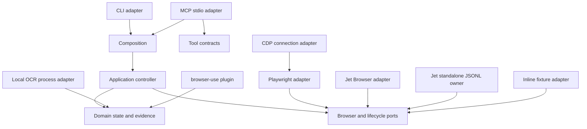

# Architecture

rea-captcha follows REA's inward dependency rule and keeps resource ownership explicit.

The browser adapter owns an observation call. The caller owns Playwright pages and managed Jet Browser sessions. The CDP composition owns only its connection and closes that connection during cleanup; it does not launch or terminate the external browser process. The Jet standalone adapter is different: it explicitly owns one child process and its WPE session, keeps ordered command waiters, and closes both in cleanup.

The controller owns its state machine and the last inspection. An event sink owns its JSONL file and serializes appends. The optional OCR runtime owns exactly one child process and rejects all pending requests if it exits.

An inspection preserves URL, title, capture time, signal source, matched value, and confidence. Policy consumes the parsed finding; downstream code does not reinterpret raw HTML.
