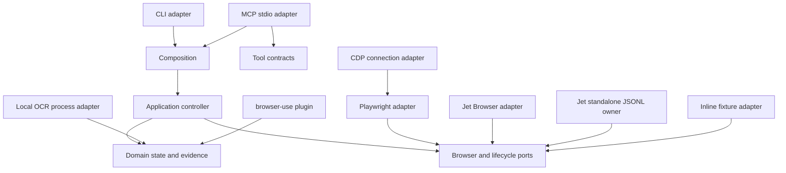

# Architecture

rea-captcha follows REA's inward dependency rule and keeps resource ownership explicit.

The browser adapter owns observation and, when explicitly configured, bounded agent actions. The caller owns Playwright pages and managed Jet Browser sessions. The CDP composition attaches to the agent's already-running browser, owns only that connection, and never launches or terminates the external browser process. Before clicking, the Playwright adapter checks the exact origin and confirms a provider-documented test sitekey; owned image/text actions require an explicit value. The Jet standalone adapter is different: it explicitly owns one child process and its WPE session, keeps ordered command waiters, and closes both in cleanup.

The controller owns its state machine, last inspection, and monotonic human-handoff generation. A human handoff returns an opaque identity bound to the caller's task, the controller's existing tab/session ID, and that generation. A newer handoff makes the older identity stale; concurrent duplicate resume callbacks share one in-flight transition; a consumed identity cannot run the lifecycle resume callback again. The application still owns the business rule inside its lifecycle port, while the controller owns the one-shot state transition and performs another fresh inspection before returning control. Event logs include the generation but never the opaque handoff ID, browser credentials, cookies, or provider challenge tokens.

An event sink owns its JSONL file and serializes appends. The optional OCR runtime owns exactly one child process and rejects all pending requests if it exits.

An inspection preserves URL, title, capture time, signal source, matched value, and confidence. Policy consumes the parsed finding; downstream code does not reinterpret raw HTML. A policy decision alone cannot authorize a provider click: the action-capable adapter independently enforces origin and test-key constraints before the controller waits for fresh server-validated evidence.
