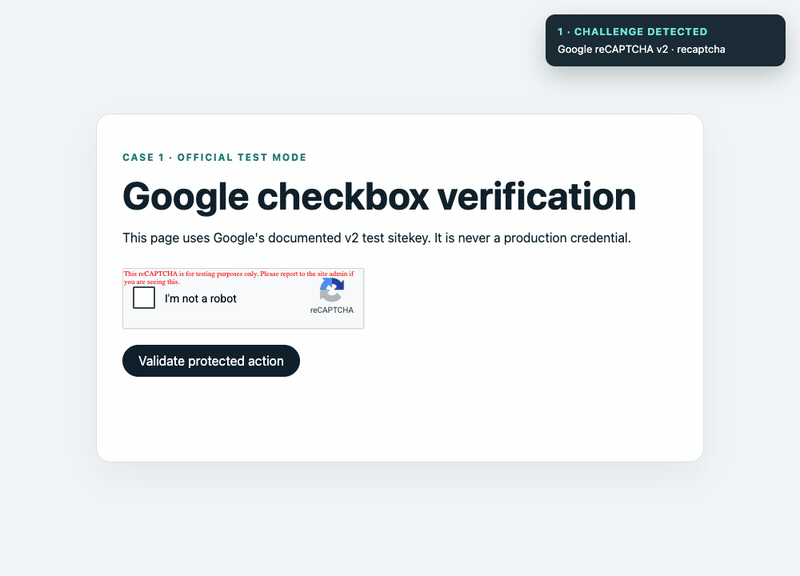
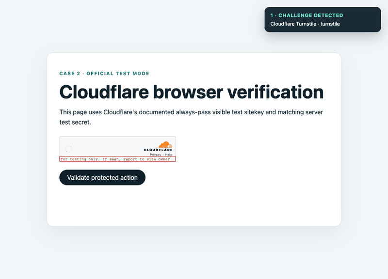
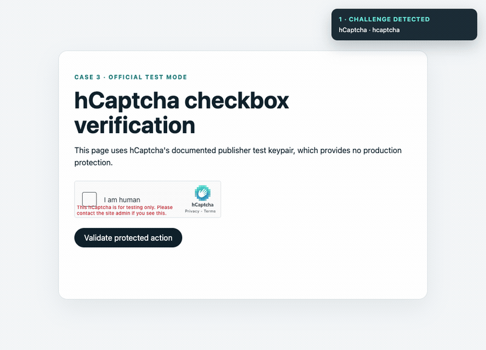
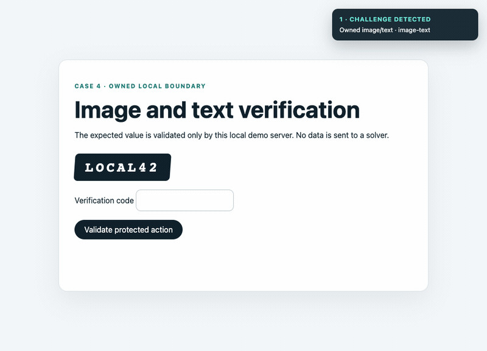

<p align="center"><a href="../../README.md">English</a> · <a href="README_zh.md">简体中文</a> · <strong>繁體中文</strong></p>

# rea-captcha

**面向瀏覽器 Agent 的本機優先驗證挑戰識別與安全人工接管。**

[](https://www.npmjs.com/package/rea-captcha) [](https://registry.modelcontextprotocol.io/v0.1/servers?search=io.github.masakaai%2Frea-captcha) [](https://skills.sh/masakaai/rea-captcha/rea-captcha) [](https://discord.gg/8Ybc32NcMt)

rea-captcha 會在瀏覽器 Agent 重複操作前識別驗證挑戰，暫停目前任務，保留原始瀏覽器工作階段供使用者可見接管，並且只在取得新的通過證據後恢復同一任務。專案提供 TypeScript SDK、本機 stdio MCP、Playwright/CDP、browser-use、相容 Vercel Skills 的 Agent Skill，以及僅限授權 origin 的選用本機 OCR。

Jet Browser 只是明確選用的適配器，不是相依套件或預設 runtime。專案沒有託管 solver、遙測或隱身繞過承諾。

## Agentic 驗證矩陣

<table align="center">
  <tr>
    <td align="center" width="50%">
      <strong>Google reCAPTCHA v2</strong><br>
      
    </td>
    <td align="center" width="50%">
      <strong>Cloudflare Turnstile</strong><br>
      
    </td>
  </tr>
  <tr>
    <td align="center" width="50%">
      <strong>hCaptcha</strong><br>
      
    </td>
    <td align="center" width="50%">
      <strong>自有圖片/文字</strong><br>
      
    </td>
  </tr>
</table>

四個案例都驗證完整的受保護操作：識別、同工作階段接管、伺服器端驗證、新的通過證據、工作階段 Cookie，以及安全恢復。前三項使用供應商真實 JavaScript、公開非正式環境測試憑證與官方 Siteverify endpoint。

## 快速開始

```sh
npm install rea-captcha
npx rea-captcha setup
npx rea-captcha doctor
npx skills add masakaai/rea-captcha --skill rea-captcha
```

需要 Node.js 22.19+、24.11+ 或 26+。`setup` 經確認後建立可審閱的 Playwright/CDP 設定，不會覆寫既有檔案，也不會安裝 Jet Browser。

## Agent 與 MCP

官方 Registry 名稱為 `io.github.masakaai/rea-captcha`，零設定啟動為 `npx -y rea-captcha mcp --stateless`。服務提供五個工具：`captcha_analyze`、`captcha_inspect`、`captcha_handoff`、`captcha_wait` 與 `captcha_resume`。第一個工具以唯讀方式分析 Agent 已持有的證據；其餘四個工具持續使用同一個已設定的瀏覽器工作階段。

狀態流程為 `inspect → blocked → handoff → 有界等待 → 新證據驗證 → resume`。未知值、缺少證據、逾時或單獨的 OCR 預測都不能授權恢復。

## 使用範圍

僅用於自有或明確授權的流程。自動完成第三方互動式挑戰、產生供應商簽章 token、搬移憑證或隱身繞過皆不在範圍內。

[架構](../architecture.md) · [案例](../cases.md) · [MCP 工具](../mcp-tools.md) · [安全政策](../../SECURITY.md) · [授權](../../LICENSE)
